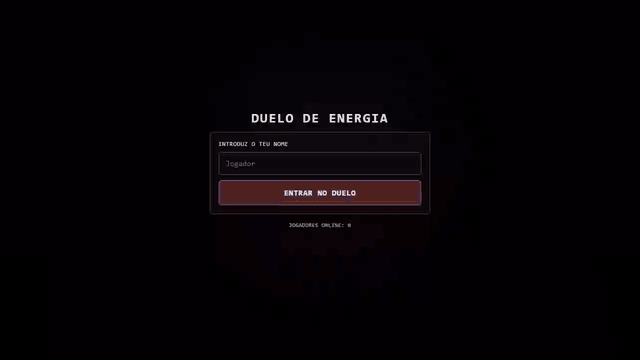
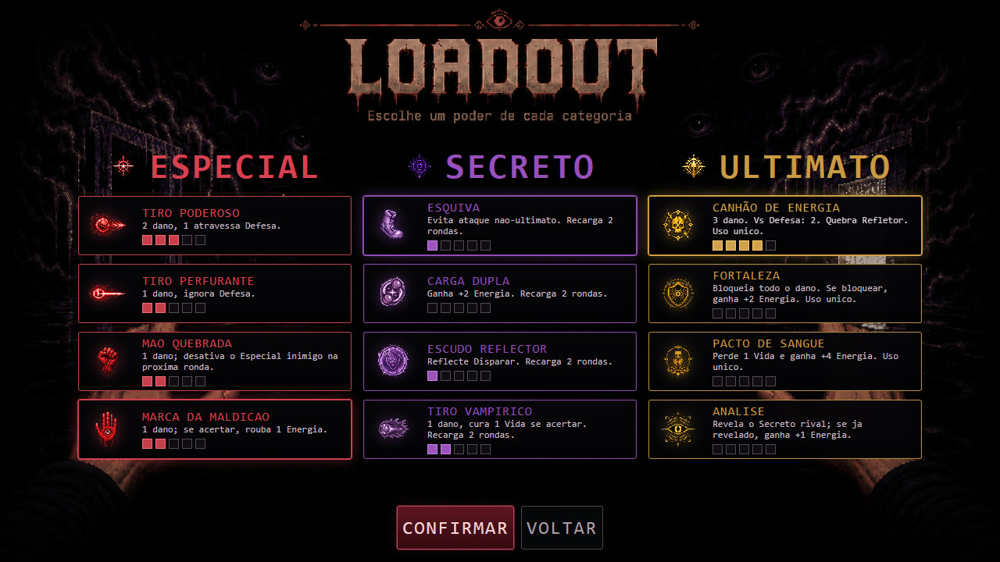
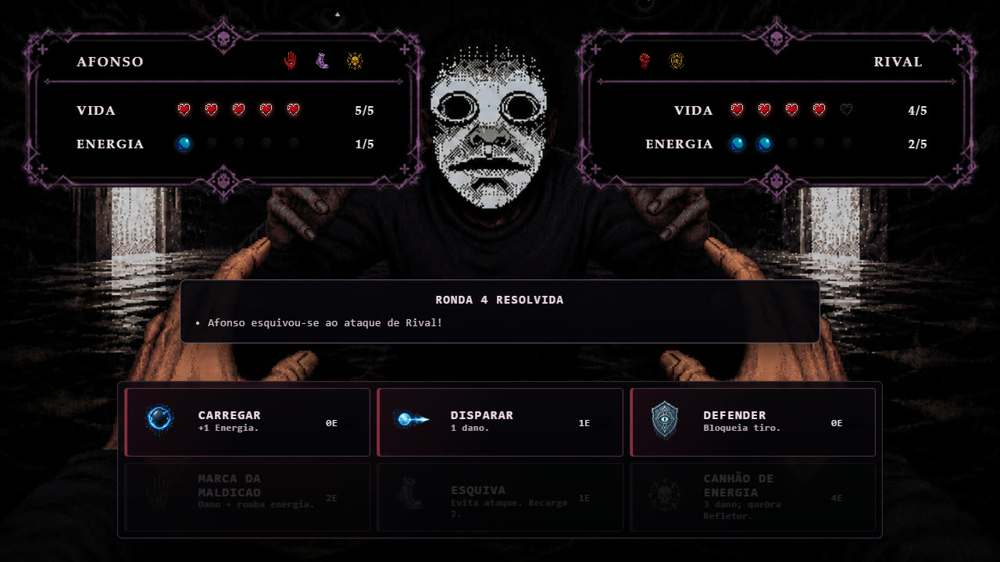

<h1 align="center">Energy Duel</h1>

<p align="center">
  <strong>A real-time 1v1 mind game for two browsers on the same network.</strong><br>
  Charge, shoot or defend. Both players lock in blind. The server decides.
</p>

<p align="center">
  <a href="https://github.com/netoaf/energy-duel/actions/workflows/test.yml"></a>
  
  
  
</p>

<p align="center">
  
</p>

<p align="center"><sub>A complete recorded match, sped up. <a href="docs/gameplay.mp4">Full-quality video</a>. Interface in Portuguese.</sub></p>

## How it plays

Each player starts with 5 life and 1 energy. Every round, both choose one action
at the same time without seeing the other's choice. Energy is the currency:
charging earns it, attacking spends it, and reading your opponent decides the match.

Before the duel, each player builds a loadout with one power from three tiers:

| Tier | Example | Rule |
| --- | --- | --- |
| Special | Curse Brand | 1 damage; steals 1 energy on hit |
| Secret | Dodge | Hidden from the rival; evades any non-ultimate attack, 2-round cooldown |
| Ultimate | Energy Cannon | 3 damage, breaks reflectors, single use |

<table>
  <tr>
    <td></td>
    <td></td>
  </tr>
  <tr>
    <td align="center"><sub>Loadout: one power per tier</sub></td>
    <td align="center"><sub>Duel: life, energy and the round log</sub></td>
  </tr>
</table>

## Under the hood

- **Server-authoritative.** Clients only send intentions. The Node.js host validates
  cost, cooldowns and phase, then resolves both actions together, so a modified
  client cannot cheat.
- **Real time over WebSocket.** Lobby, loadout, rounds and rematch stay in sync
  across any device on the local network.
- **Pure rules engine.** `game.js` holds every rule and has no network or I/O
  code, so each interaction can be tested in isolation.
- **Anti-stall design.** Shield spam gets more expensive and long matches end in
  sudden death.
- **Tested.** 37 combat scenarios run on every push, on Node 22 and 24.

## Run it

```bash
npm install
npm start
```

Open `http://localhost:3000`. The second player joins from another device at
`http://<your-local-ip>:3000`.

The host listens on all interfaces, so play on a network you trust.

```bash
npm test        # combat resolution scenarios
npm run check   # syntax check for every module
```

## Structure

```text
game.js     rules, validation and round resolution (no I/O)
host.js     Express + WebSocket server, lobby and match lifecycle
public/     client rendering, UI assets and styles
test.js     combat resolution scenarios
```

## Scope

A portfolio project focused on game-state integrity. No public hosting, accounts
or matchmaking.
